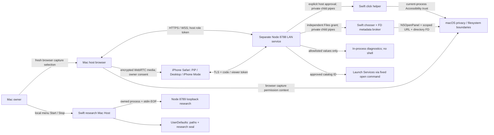

# M13 — Native Mac companion architecture and security review

Review date: 2026-10-28–29. Status: **bounded research hardening and proposed production architecture; not distribution approval**. Mission: [owner-approved handoff](M13-ASTRA-HANDOFF.md). Implementation plan: [M13 plan](M13-IMPLEMENTATION-PLAN.md).

## Decision and evidence boundary

Keep the working browser capture → WebRTC → iPhone Safari PiP path. Build toward an explicitly launched, per-user, Developer ID signed AppKit host that owns Mac consent and capability lifetimes. Package a fixed transport runtime and move sensitive operations behind narrow, independently authorized native interfaces. Prefer embedded XPC for eventual Files/service isolation; do not introduce a root daemon, login item, native capture backend, new listener, or native iPhone replacement in M13.

This is an engineering recommendation for review, not an owner-approved production entitlement design. M13 implements defect repairs in existing research boundaries only. Node remains a trusted authority in the current implementation. Signing or changing stdio to XPC alone would not contain a compromised Node dependency.

Three product experiences remain complementary:

- **PiP:** live, floating, view-only video during other iPhone apps; never an input grant.
- **Desktop Mode:** full stream with separately requested, Mac-approved remote clicks.
- **iPhone Mode:** bounded Mac app interactions, metadata-only Files and allowlisted Terminal Preview. No arbitrary PTY, commands, file contents, transfer or writes.

The owner reported iPhone 16 Safari PiP continuing live while WhatsApp was foreground on 2026-10-26. That is feasibility evidence, not an independently observed M13 hardware pass. `public/` is unchanged by this batch. Existing independently started **8788 HTTPS trusted-LAN** and native-managed **127.0.0.1:8789 HTTP research** services remain separate. No listener configuration changes.

### Repository baseline actually inspected

- M12: `1c19602443f372a7cf49d59651a5daca27144891`.
- Current main at start: `5a2759eb6822855ac0c7810c7132b2bd627a2473` (PR #40). Git comparison shows one documentation-only commit: README, ROADMAP and M13 handoff. Source and workflow match M12.
- [M12 push CI](https://github.com/damxntheman/FLOATDESK/actions/runs/40634693078): all three jobs successful; job IDs `122638834141`, `122638834399`, `122638834454`.
- [Current-main push CI](https://github.com/damxntheman/FLOATDESK/actions/runs/40636211702): Node job `122643662675` log reports **58 tests, 58 pass, 0 fail**; native Files `122643662192` and Mac bundle `122643662385` successful, including individual native lifecycle, lock, source-seal and release-negative steps.
- Independently ran unchanged current-main `npm test` on Linux Node **v24.19.0**, npm **11.9.0**: **58/58 pass**. CI uses Node 22 for its Node job. Native AppKit/Swift execution is validated on CI, not this Linux workspace.
- Read source, tests, README, SECURITY, CONTRIBUTING, ARCHITECTURE, ROADMAP, TESTING and M2–M13 technical context. Historical milestone prose sometimes describes superseded behavior (M8 opens only a dashboard; M4 Files is unreachable; touch is not implemented). Current code and dated evidence take precedence. The existing skill snapshot is from October 26, before M3–M12; it is not current capability evidence.

## Trust boundaries and threat model

The diagram describes current code, including the fact that the native menu **does not own the 8788 service or its grants**. Host-role possession and a loopback source address are presently accepted as Mac approval; neither proves a human clicked a native consent surface.

**Assets:** live screen confidentiality; Mac input authority; selected directory names (also sensitive); app inventory/launch authority; pairing/resume capabilities; process identity/lifetime; TLS and future signing/update keys; availability and prompt integrity. Video is peer-to-peer with no server recording, but Node serves both clients and controls signaling: a compromised server can alter frontend code and defeat application security. Encrypted WebRTC is not independent identity verification against that server.

| Attacker / boundary | Concrete abuse case | Current protection / limit |
| --- | --- | --- |
| Unpaired phone or LAN peer → Node | Guess code, create many rooms, flood signaling | 8-character random code, 10-minute join window; six join attempts/IP/10 minutes; 32 KiB WS payload; no global connection/room/byte budget |
| Paired compromised viewer → capability handlers | Forge approval, request paths/commands, replay actions after revoke | Role checks, separate grants, finite scope/rates, strict Files schemas; pairing does not permit privileged actions by itself |
| Web page or same-user process → loopback host API | Claim host role, impersonate owner, approve its own paired viewer | Origin compares to request Host; local IP check; no native owner authentication. Same-user clients can set headers. Browser DNS-rebinding applicability requires separate browser/network testing |
| Stolen host/viewer token → session | Displace live socket and replay until expiry | 256-bit role token, constant-time equal-length compare, one-hour session, displaced socket detached. No token rotation or device identity |
| Compromised Node/dependency → native helper | Send valid clicks/listings without real approval; retain permissions | Inherited pipe limits reachability, not parent authority. Helpers trust Node and lack independent session expiry |
| Same-user filesystem actor → executable / folder | Replace selected Node/helper/source, mutate dependency; swap legacy folder path | Source seal detects selected changes only; native FD traversal rejects symlinks; neither is a sandbox against same-user compromise |
| Crash, suspend, half-open transport → teardown | Orphan process, stale grant, video outliving signaling lease | Parent EOF is cooperative; grant check on use + periodic expiry; actual streaming and OS permissions require independent lifecycle evidence |

Assume trusted owner-controlled Mac, trusted LAN, untampered OS/browser, no privileged malware, and the exact configured development source. These assumptions explain the research scope; they are not acceptable substitutes for a distribution design. No test here uses private file contents, personal addresses or live credentials.

## Prioritized findings

Severity describes practical impact with the stated preconditions, not a CVSS score. References identify code in the baseline or the repaired symbols on this branch.

| ID / priority | Finding, evidence and realistic condition | Disposition |
| --- | --- | --- |
| F1 **High / release blocker** | `src/server.js` `verifyClient`, `create`, `isLocalPeer` and approve handlers: host role can be created without native owner authentication. A same-user WebSocket client can create a host room, pair a viewer and issue approvals. If an input helper is configured/trusted, Node will accept this as approval. A remote LAN-only client cannot pass the loopback approval check. Origin equals a Host-derived value, not a configured authority. No real-browser DNS-rebinding exploit is claimed. | Native owner consent authority plus authenticated bootstrap/peer identity; exact authority allowlist; deny remote host creation. Requires compatibility/design review; not silently changed here. |
| F2 **High / fixed research defect** | `src/registry.js` `prune` was called inside `create/join/resume/forClient/peer`; it removed expired rooms before `src/server.js` housekeeping could revoke helpers or send `session-ended`. A request or async completion at expiry could lose the room's teardown path, retaining a native process and preventing ordinary browser media-stop notification. | Synchronous registry removal callback centralizes expiry/stop disposal. Fake-clock and server-harness regressions exercise request-time expiry, stop and stale sockets. This does not force-stop a disconnected browser's media. |
| F3 **High / fixed boundary race** | `src/server.js` resume revoked only when the displaced socket was OPEN. A CLOSING socket was already detached from registry, so its close callback could not revoke; fresh socket could inherit a grant. | Every authenticated resume revokes all four grants regardless of prior socket readiness; tests cover closing replacement. Pairing remains resumable; permissions require fresh approval. |
| F4 **High / release blocker** | `FloatdeskAgent.swift`, `FloatdeskNativeFilesBroker.swift`, `src/control.js`, `src/files-grant.js`: Node alone holds grant authority. Helpers validate input shape but have no independently enforced TTL/session epoch or owner proof. A compromised Node can invoke permitted helper operations; stdio and unsigned paths are not verified code identity. `readLine` allocates before checking length. | Move consent/grant authority into native UI/brokers, bounded incremental native parser, operation-level scope/expiry, authenticated signed peers. Do not enable new capabilities first. |
| F5 **High / release blocker** | `FloatdeskSourceSeal.swift`, `FloatdeskLocalService.swift`, `package.json`: hash excludes installed `node_modules`; there is no tracked lockfile. Source and Node paths are mutable after checking; UserDefaults and hashes share the same user's trust. Native optional helpers are configured by paths without signature validation. | Ship immutable reviewed app resources, fixed runtime/dependency artifacts, reproducible lock/install, signature/identifier checks and signed update metadata. M12 remains accidental-change detection. |
| F6 **High / unresolved privacy policy** | `public/client.js` `socket.onclose` preserves peer/capture for recovery and ignores a local session expiry deadline; Node cannot force termination of already established media when both signaling paths are unavailable. No heartbeat detects all half-open sockets promptly. `session-ended` normally stops tracks; local Stop sharing directly stops tracks. | Design a bounded host media lease with explicit reconnect grace and lock/sleep behavior, test changing pixels on M1/iPhone16, preserve useful PiP/recovery. Not altered without device validation. |
| F7 **Medium / partial fix** | `scripts/verify-mac-release.sh` originally matched `runtime` anywhere in `codesign` text (including path) and Team ID as substring. It also lacks nested-code inventory, entitlement policy, timestamp/ticket verification and quarantined install test. | Exact identity/flag parsing + negative regression fixtures in M13. `spctl` success and parser mocks are not notarization proof; remaining production pipeline work is mandatory. |
| F8 **Medium / fixed correctness** | `FloatdeskNativeFilesBroker.swift` duplicated the selected root FD; duplicated descriptors share an open file description/directory offset. Repeated root listing could be empty. Inline `fdopendir(dup(fd))` leaked the duplicate on failure. | Open `.` relative to root for an independent offset, explicit ownership/close on failure. macOS fixture repeats root and nested listing and checks equality plus symlink/traversal denial. |
| F9 **Medium / fixed IPC integrity** | `src/native-files-broker.js` used `String(chunk)` per stdout chunk; a multibyte UTF-8 name split across chunks became replacement characters. Invalid bytes were accepted after lossy conversion; stdout EOF awaited timeout. | Bounded byte framing, fatal UTF-8 decoding of complete frames, immediate EOF failure. Three regressions demonstrated pre-fix failures. |
| F10 **Medium / release blocker** | `FloatdeskLocalService.swift` `isRunning` proves a child exists, not that it owns/responds on 8789; advisory lock does not prevent unrelated listener spoofing. Stop/owner EOF is cooperative, no bounded termination acknowledgement/kill escalation; lock can release on owner death before hung child exits. | Native-owned service generation/challenge, readiness handshake, bounded drain/termination against retained process identity; invalidate grants first. Preserve independent 8788 lifetime. |
| F11 **Medium / open** | `src/server.js` sends lack output-buffer bounds, room creation/probe requests lack global budgets and ping/pong heartbeat; app discovery is synchronous. Per-IP join throttling and payload size do not bound total resource use. | Cap unauthenticated connections/rooms, probes, pending work and bytes; rate-limit discovery, expire idle sockets. Test LAN/loopback abuse without new listeners. |
| F12 **Medium / research-only fallback** | `src/files-policy.js` separates `realpath/lstat/readdir` checks, leaving pathname-swap races; native broker avoids this for traversal but folder moves/mounts and root-selection race policy remain explicit assumptions. Neither sandbox nor TCC access was proven by CI. | Keep M7 preferred. Remove M5 fallback from production package; independently validate chooser/FD/scoped lifetime, rename/mount behavior. Metadata-only limits impact, not sensitivity. |
| F13 **Medium / open** | `src/mac-apps.js` launches locally discovered bundles by ID, with fixed `/usr/bin/open` arguments; it is intentionally software execution, not proof of bundle trust. Revocation cannot undo an already dispatched launch; asynchronous completion checks phase, not a grant generation/expiry. `FloatdeskAgent.swift` checks display topology/AX only at startup. | Bind async replies to grant epoch; recheck native action conditions; narrow app scope and test display hotplug/OS revoke. No shell string injection was found in the inspected launch/diagnostic path. |
| F14 **Low / documentation debt** | Historical SECURITY/ARCHITECTURE/TESTING entries contradict newer implemented milestones or owner-reported checks. Native inventory calls a path “configured,” not authenticated; companion hello validates protocol/all-false capabilities only. | Current summary points to this review; maintain explicit code/CI/owner-report/independent-test distinctions. Do not reinterpret “ready” as TCC or signed provenance. |
| F15 **Medium / availability** | `FloatdeskMacHost.swift` `menuWillOpen` calls `settings.configured`, which hashes source and Node synchronously on the main actor. Large/slow selected files can stall the menu including Stop. Files enumeration limits returned items, not total skipped entries scanned. | Move integrity work off the UI thread with cancellation/generation checks and preserve direct Stop; bound scanner work. Neither freeze nor performance impact was measured on M1. |
| F16 **Low / compatibility** | Native selected labels use 80 Swift Characters while Node accepts 80 UTF-8 bytes; relative path limits also differ between UTF-16 units and UTF-8 bytes. Long Unicode names can fail closed despite the repaired split-byte handling. | Unify protocol byte limits in a follow-up; no scope bypass or Unicode coverage beyond the stated regression tests is claimed. |

No claim is made that this audit is exhaustive or that a hostile same-user process is contained. The unprivileged, scrubbed 8789 service does not configure native helper paths; F1's native-action consequence principally concerns an opted-in standalone Mac service, not automatic privilege enablement in 8789.

## Architecture decision record

### Options

| Model | Advantages | Cost / boundary |
| --- | --- | --- |
| **A — AppKit consent authority + packaged Node transport + narrow native services (recommended staged path)** | Retains browser/WebRTC/PiP, small migration steps, compatible with solo developer/M1; clear native UI ownership | Signing Node/V8 and dependencies requires work; unsandboxed Node remains broad same-user code. Native authority must verify end-device authorization rather than trust arbitrary transport assertions |
| **B — Mostly native signaling/capability host + sandboxed XPC services** | Less JS/runtime supply chain; typed Apple IPC and smaller service privilege sets | Larger protocol rewrite, browser parity and TCC matrix; same-user isolation still needs real sandbox policy. Does not require replacing Safari PiP |
| **C — Electron-style wrapper or one all-powerful native process** | Simple UI/process integration | Larger trusted runtime or combined network/privacy authority, harder least privilege; no benefit justifying migration now |

Choose A as a migration direction; do not ship its intermediate research state. Keep B available if constraining Node and its hardened-runtime requirements costs more than replacing signaling. A root helper or system daemon is unjustified: operations concern the logged-in owner only.

### Application, service and lifetime structure

The future app owns visible Start/Stop, pairing confirmation, per-capability prompts, grant ledger and revoke-all. It packages exact helpers/runtime/resources; production does not execute owner-selected checkout or arbitrary Node paths. Persist only non-sensitive preferences in UserDefaults. Future long-lived identity keys belong in Keychain with a reviewed access policy; grants stay volatile. No secrets in process arguments, URLs, logs or plain preference storage. Existing sessionStorage bearer tokens are ephemeral browser research credentials, not hardware-backed identities.

Use a private inherited pipe for the initial packaged Node transport with versioned, bounded requests, explicit service-generation challenge and fail-closed readiness. This is a reachability channel, not a sandbox. For native services prefer bundled, on-demand XPC, exact code-signing requirements on both ends, narrowly typed interfaces and independent authorization. Never accept a PID, path, bundle-name string or claimed Team ID as proof. No named world-accessible IPC endpoint or root privilege is necessary.

Apple documents embedded XPC lifetime as per-client and launchd-managed [A5]. Crash restart does not restore authorization. On invalidation/interruption, revoke native grants, close scope FDs, stop accepting operations and require fresh approval. Keep Files chooser and enumeration in the same tested permission context; if UI is moved to the app, transfer an appropriate scoped bookmark deliberately and test its lifetime. Merely passing a path does not transfer access [A10]. Input remains a distinct component with its own permission and grant. A signed caller may still be compromised; authorization must be checked per operation.

Recommended lifecycle: `stopped → starting(generation) → authenticated-ready → draining → stopped/failed`. Owner Start is required. Unexpected exit returns to failed/off, not auto-recovery with grants. Stop first invalidates generations/grants, then closes capture/FDs and sends bounded drain, waits for acknowledgement/exit, then terminates only the owned process if necessary. Final forced-kill supervision needs careful process-identity and descendant testing. Never kill by port or stale PID. Do not have the native menu manage the existing independent 8788 service in this milestone.

### Authentication and independent authorization

For the next migration, native UI must authenticate its transport connection and confirm owner intent. A browser dashboard must bootstrap through an owner-initiated, single-use, short-lived local credential with exact allowed authority and Origin, no token in URL/logs; the UX and delivery mechanism remain a design gate. Restrict host creation/resume to this authenticated authority; LAN access is viewer-only. TLS cert trust must remain valid; neither Origin nor IP is identity.

Native authority must also bind the approved phone identity to its session. If Node can mint a viewer identity or issue/replay grants by itself, moving the prompt to Swift is insufficient. Select an established authenticated channel/protocol and review key provisioning, browser compatibility and transcript/session binding before implementing durable pairing; do not invent custom cryptography. A compromised Node serving browser JavaScript cannot be defeated by a token embedded in that same page. A stronger compromised-transport threat model requires independently trusted client code/channel as well as native isolation; preserve Safari PiP until that alternative is validated.

Proposed capability envelope (design, not enabled wire protocol): protocol version, opaque session ID, service generation, viewer identity, capability kind, opaque scope ID, grant ID/epoch, monotonic expiry and monotonically increasing operation sequence. The native ledger is the authority; remote-supplied claims never create grants. Check exact schema, message size, channel identity, kind/scope, live session, epoch, expiry and replay/rate bounds before dispatch. Revocation atomically invalidates epoch and cancels pending work; late completions check the same epoch before emission. No generic `execute`, arbitrary path, argument vector or shell method.

### Signing, sandbox, notarization and updates

Use Developer ID Application for direct distribution; stable app/helper identifiers and designated requirements support update identity [A1,A4]. Hardened runtime, App Sandbox, TCC and FLOATDESK grants are four separate mechanisms. Recommend initially prototyping a nonsandboxed AppKit owner app for compatibility, with separately sandboxed transport/Files wherever feasible. **Do not claim containment or approve distribution until this sandbox split is validated.** Sandbox inheritance is not an independently narrower child policy [A7]. No Full Disk Access, Apple Events automation, broad writable filesystem entitlement or background-capture privilege is justified for the current features.

Inspect the exact packaged Node/V8 build on Apple silicon. Hardened runtime can require a narrowly justified JIT exception; evaluate JITless operation before deciding. Never add unsigned-executable-memory or disable-library-validation by assumption [A3]. Entitlements belong to each executable and must be individually reviewed.

Future release sequence: reproducible locked dependency install → immutable bundle manifest → sign nested executables/services and outer app with approved identity, runtime and secure timestamp → verify all identities/entitlements (no `get-task-allow`) → submit with Xcode/notarytool → inspect Accepted submission and full log → staple and validate ticket → Gatekeeper assessment → quarantined download/install on clean supported Mac, including offline validation. Notarization is automated scanning, not App Review or security certification [A1,A2]. M13 only tightens a necessary preliminary check; it does not supply this pipeline.

Updates must use authenticated signed manifests/artifacts, version compatibility and rollback policy; never self-update executable JS outside the signed bundle. Before replacement, stop sessions and revoke volatile grants. Rollback is to an explicitly approved signed compatible artifact, never automatic restoration of grants or a known-vulnerable version. Stable signing identity does not guarantee every TCC permission survives update/rollback; test it. Keep signing/notarization credentials in the owner's approved secure workflow, never chat or repository.

## Capability consent and revocation matrix

Current TTLs are from `registry.js`, `control.js`, `app-access.js`, `terminal-grant.js`, `files-grant.js`. Future native enforcement must use monotonic deadlines and session/service epochs; current deadlines use wall-clock time and must be treated as research behavior under clock changes.

| Capability | Authority, scope and TTL | Binding / revocation / visible cue | OS privacy and excluded power |
| --- | --- | --- | --- |
| Pair/view | Mac creates room, phone uses code; 10-minute join, one-hour session; 256-bit per-role resume tokens | One viewer; host End session/expiry/process loss invalidates server state. Code/status shown. Native confirmation and durable identity not implemented | Pairing alone does not start capture, input, apps, Terminal or Files |
| Capture + PiP | Fresh Mac browser selection; selected display/window; no independent fixed capture TTL today | Current track/peer; Mac Stop sharing stops tracks, End session resets; browser share indicator, host status, phone PiP. Signaling-loss/lease policy F6 remains open | Browser/macOS capture context; PiP is presentation, never input. Native ScreenCaptureKit consent separately required if introduced |
| Click | Phone request + local host approval within 30s + agent readiness; 120s active; normalized left clicks, one display, ≥120ms spacing | Room/socket, revoke on capture change, disconnect/resume, expiry, agent failure, session end; Mac Revoke and iPhone Exit | Actual agent checks Accessibility. No keyboard, drag, scroll or PiP control. OS trust does not grant phone authority |
| App discovery / launch | Separate 30s approval window, 5-minute grant; current bounded top-level catalog, launch by ID, ≥1500ms launch spacing | Room/socket; explicit revoke, disconnect/resume, expiry/end; app access state shown | Launch Services, no Accessibility grant implied; no arbitrary paths/arguments. Already launched applications cannot be unlaunched by revoke |
| Terminal Preview | Separate Mac approval within 30s, 3 minutes; `help/date/uptime/system` only | Independent grant, action rate, revoke/disconnect/resume/expiry/end; preview label and output | Node OS diagnostics, no Terminal process attachment, shell, PTY, file contents or commands |
| Files metadata | Mac approval starts picker within 30s; selection ≤90s; selected root, 5-minute grant; bounded names/types | Independent grant + native root FD; revoke/disconnect/resume/timeout/helper death/end closes broker; Mac picker and visible scope label | NSOpenPanel/scoped URLs and OS filesystem/TCC still apply. No contents, writes, transfer, traversal or symlink following |
| Future PTY / writes / transfer | **Disabled, no grant type or authority exists** | Requires separate security design and explicit owner approval | No entitlement or current grant enables it |

Recommended local audit metadata: capability kind, pseudonymous session/grant ID, generation, approve/revoke/deny/expire reason, coarse timestamp and helper failure category. Keep bounded local retention, owner-clearable, no telemetry. Do not log paths, filenames, screen content, commands/output, tokens, actual IPs or signing secrets. This audit ledger is proposed, not implemented. OS permission state and application grant state must be displayed separately; losing one must not silently regain the other.

## Verified Apple contracts

Official pages fetched live through Firecrawl (`maxAge:0`) on 2026-10-28. These establish documented contracts, not actual app behavior. Availability is stated only where verified. No entitlement files or permissions were added.

| Ref | Official source and relevant verified claim |
| --- | --- |
| A1 | [Notarizing macOS software](https://developer.apple.com/documentation/security/notarizing-macos-software-before-distribution): valid signatures for distributed executables, Developer ID, hardened runtime, secure timestamp, no enabled get-task-allow; notarization is not App Review |
| A2 | [Resolving common notarization issues](https://developer.apple.com/documentation/security/resolving-common-notarization-issues): strict signature verification, runtime/timestamp requirements; deep verification is not a substitute for deliberate nested signing |
| A3 | [Hardened Runtime](https://developer.apple.com/documentation/security/hardened-runtime): only necessary exceptions; JIT/MAP_JIT, executable entitlements; not a filesystem sandbox |
| A4 | [TN3127 Code Signing Requirements](https://developer.apple.com/documentation/technotes/tn3127-inside-code-signing-requirements): stable designated identity and distinct helper identifiers; ad-hoc identity changes with code; constrain Team ID and exact signing identifier |
| A5 | [XPC](https://developer.apple.com/documentation/xpc): embedded service per client, client lifetime, launchd demand/crash handling; distinct from user LaunchAgent/system LaunchDaemon |
| A6 | [NSXPCConnection.setCodeSigningRequirement](https://developer.apple.com/documentation/foundation/nsxpcconnection/setcodesigningrequirement(_:)): macOS13+, call once before resume; malformed requirement fatal in Swift, mismatch invalidates. Matches current app's macOS13 floor; not proof of owner intent |
| A7 | [Embedding a helper in a sandboxed app](https://developer.apple.com/documentation/xcode/embedding-a-helper-tool-in-a-sandboxed-app): XPC often preferable; inherited sandbox helper needs appropriate sandbox/inherit configuration. Do not copy this App Store example as a blanket FLOATDESK entitlement recipe |
| A8 | [ScreenCaptureKit sample](https://developer.apple.com/documentation/screencapturekit/capturing-screen-content-in-macos): sample currently requires macOS15/Xcode16 and Screen Recording approval/restart; sample minimum is not the framework minimum or a universal prompt contract |
| A9 | [AXIsProcessTrusted](https://developer.apple.com/documentation/applicationservices/1460720-axisprocesstrusted), [with options](https://developer.apple.com/documentation/applicationservices/1459186-axisprocesstrustedwithoptions): current-process trust; asynchronous prompt does not change the return result |
| A10 | [Sandbox file access](https://developer.apple.com/documentation/security/accessing-files-from-the-macos-app-sandbox), [security-scoped resource lifetime](https://developer.apple.com/documentation/foundation/nsurl/startaccessingsecurityscopedresource()): user-selected read-only access, folder descendants, balanced successful scope access; cross-process bookmarks, no automatic Full Disk Access. Do not assume a raw path or another process's permission transfers |
| A11 | [SMAppService](https://developer.apple.com/documentation/servicemanagement/smappservice): macOS13+ user-approved bundled background services; unnecessary for explicit app-owned lifetime, unused here |
| A12 | [TN3179 Local Network Privacy](https://developer.apple.com/documentation/technotes/tn3179-understanding-local-network-privacy): macOS15+ local-network privacy; outgoing local traffic requires access, incoming TCP listening/accept alone does not. Responsible-code attribution/stable signing matters. Test bundled Node/browser launch contexts; add usage description only when actual native LAN access is designed |

## Remediation sequence and mandatory gates

1. **M13 safe batch:** repair existing expiry/resume disposal, Files framing/FD behavior and release parser; regressions, independent diff review and full CI. Review this ADR before any production migration.
2. **M14 owner identity seam:** design authenticated native authority/bootstrap and exact host/Origin policy; inventory message authority and add budgets/heartbeat. Regression-test unpaired/local/remote callers, wrong identity, replay, revoke/expiry and async generations. Decide media lease/reconnect grace with physical PiP evidence before changing it.
3. **M15 packaged native boundary:** fixed runtime/resources/lockfile; signed identifiers and peer requirements; native grant ledger; prototype Files XPC sandbox/permission context. Test wrong-team/wrong-ID helper rejection and native expiry independent of Node. Resolve how trusted phone identity reaches native authority under the selected threat model.
4. **M16 distribution candidate:** minimal entitlement review, Developer ID pipeline, hardened Node tests, notarization/stapling and update policy. Owner performs credential setup through secure Apple/development tooling. No release until physical acceptance and independent security review.

Physical testing is deferred, so these remain **NOT RUN**:

- MacBook M1 GUI Start/Stop/Quit/crash, port occupied by unrelated process, child hung, lock ownership, repeat restart; confirm 8788 stays independent. Never terminate an unrelated process by port.
- Signed app and actual helper Screen Recording/Accessibility identity: deny, approve, revoke during operation, update/rollback, display change, lock/sleep/wake. Browser identity does not imply helper consent; missing permission must fail closed.
- Native Files NSOpenPanel cancel/approve on harmless fixture; actual sandbox scope/URL lifetime; Unicode names, root/nested repeated listing, renamed folder/mount policy, symlink refusal, expiry/revoke/process crash closes access. No personal files required.
- iPhone 16 Safari changing-pixel PiP while another app is foreground; return, capture stop/privacy, Desktop clicks only under separate approval, Files/Terminal isolation; short/long outage, signaling-only outage, force-quit, lock/unlock and battery/thermal measurements. No native PiP replacement until independently validated on actual hardware.
- Signed bundled Node/helper operation under hardened runtime, peer-requirement negative tests, local-network denial/recovery, clean quarantined install/offline Gatekeeper and notarized update/rollback.

## Implementation evidence and GPT-6 handback

M13 source changes are deliberately reviewable without new permissions: one session disposal boundary; unconditional grant revocation on resume; lossless/fail-closed Files frames; independent directory offsets and FD cleanup; exact release signature-field checks. Browser UI, capture and listener configuration are unchanged. Rollback is reverting this PR's code commit; no state migration or installed service is created. Reverting also restores the identified defects, so prefer a corrective follow-up if a regression is found.

Final PR commit hashes, automated results and CI links are recorded below after verification. No hardware, Developer ID signing, notarization, App Sandbox or TCC success is inferred from these checks.

### Local verification before PR

- Final combined `npm test`: **71 tests, 71 pass, 0 fail**, Linux Node v24.19.0. Baseline: 58/58; added 13 cases (registry 2, server lifecycle 5, Files IPC 3, release parser 3). Syntax checks: `node --check public/client.js`, `node --check src/server.js`, `bash -n scripts/verify-mac-release.sh`; `git diff --check` clean.
- Regression failures observed before repair: missing registry disposal callbacks, request-time expiry/closing-socket resume/late Files completion, throwing input-pipe cleanup, split and malformed UTF-8/EOF, runtime-path and signer-field spoofing. Release tests stub CLI output; they do not exercise an Apple-issued signature.
- Native Files repeated-offset mechanism reproduced with POSIX directory enumeration on Linux; exact Darwin behavior is covered by the expanded macOS fixture. Local Linux cannot compile AppKit or exercise TCC.
- Independent reviewers inspected session/native source; a separate Apple-research reviewer checked the combined fixes and ADR. No unresolved must-fix issue was reported in that review. This is agent-assisted review, not external security certification.
- Initial sandbox `npm test` could not open loopback sockets and showed a signaling failure; rerunning with approved test-process permissions produced the complete 71-case pass above. Public source/dependency retrieval initially used the GitHub connector; the final working copy was reconciled to actual Git history and installed `ws@8.18.3` through npm. No reconstructed snapshot commit is in the PR ancestry.

For GPT-6: fetch current main and this PR; read this review, the owner handoff and implementation plan; verify the reviewed commit and CI again. Finish any PR review feedback without silently merging architecture into runtime. Start M14 with F1/F4/F6's authority and media-lease decisions, preserving all three experiences. When hardware work resumes, record OS/browser versions and individual observed results against the checklist above. Opus remains reserved for later iPhone visual design, after functional/security boundaries are stable.
