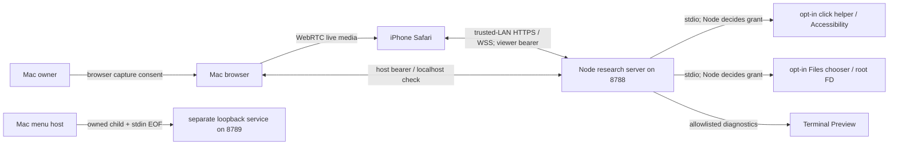

# M14 — Native owner authority and capability foundation

Status: research-only, disconnected from all live operations. [M14 issue](https://github.com/damxntheman/FLOATDESK/issues/43); [M13 review](M13-ASTRA-REVIEW.md). No native permission, XPC, signature, entitlement, listener, browser, PiP or streaming change is authorized or implemented here.

## Verified starting point and evidence

On 2026-10-29 GitHub `main` was `75500c88aead0175d9d2e7f3240001466d6bf96f`, the squash merge of [M13 PR #42](https://github.com/damxntheman/FLOATDESK/pull/42). The feature branch starts at that commit. [Merged-main CI run 40920823963](https://github.com/damxntheman/FLOATDESK/actions/runs/40920823963) succeeded in Node and both macOS jobs; its Node log reports 71 tests, 71 pass. Local baseline `npm test` independently reported 71/71 on Linux Node v24.19.0 with loopback-enabled test permissions. This is not MacBook M1/iPhone 16 acceptance. The October 26 skill baseline predates M3–M13; current source and newer dated owner reports govern.

## Current trust boundaries and threat model

`src/server.js` compares Origin to request Host and allows `create` without authenticating a native owner; app, Terminal, Files and input approvals require host role plus a loopback peer. `src/registry.js` generates 10-minute pairing codes and role-specific 256-bit resume tokens, supports one viewer and one-hour sessions, and M13 revokes on resume/disconnect/stop/expiry. These controls are useful against unpaired viewers, but a same-user process can originate a local host session and provide headers; local network address, Origin, host role or token is not proof of a real owner action. DNS-rebinding is a threat to investigate, not a demonstrated exploit here.

A compromised paired viewer can send arbitrary protocol messages and attempt replay or cross-session confusion; current role/grant/allowlist checks limit its actions. A malicious browser script can act with the page's authority. A compromised Node dependency can alter delivered browser code, invent approvals and send valid native helper commands: `FloatdeskAgent.swift` accepts stdin after its Accessibility check; `FloatdeskNativeFilesBroker.swift` keeps the chosen FD and trusts its parent to close the process at grant expiry. Node's possession of a pipe is not owner consent. Node can disrupt signaling or relay old messages even in a future authenticated-channel design. OS capture consent, Accessibility and file scope are separate from application grants. A malicious same-user process with Accessibility/UI-injection privileges and a compromised OS are not contained by the proposed UI alone.

Browser capture and Safari PiP remain independent of input. On signaling loss `public/client.js` keeps recovery state, and an already established WebRTC media connection is not forcibly expired by the server; F6's offline media lease therefore requires a separate design and device evidence. The owner reported live iPhone 16 Safari PiP while another app was foreground; this is a prior owner report, not M14 hardware verification.

## Proposed owner and viewer authentication (not implemented)

**Recommended target:** a separately signed native Mac authority owns explicit, visible on-Mac approval and revocation, displaying the independently verified device, requested capability, scope and duration. A native iPhone client with its own protected device key and pinned Mac identity authenticates directly to that authority using a reviewed standard authenticated transport, such as mutual TLS 1.3 with enrolled per-device credentials. The Mac verifies the viewer credential and session transcript itself; a transport relay may forward ciphertext but cannot manufacture authenticated requests or change approved scope. Provision initial identity through Mac-local enrollment and an out-of-band QR/fingerprint comparison on both trusted devices, reviewed for binding, cancellation, recovery and key rotation. Key storage and algorithms must be selected from platform-supported facilities and an existing audited implementation; this is an architectural direction, not a new cryptographic protocol or implemented pairing.

An unlocked trusted Mac UI event is an operational consent signal, not cryptographic proof of human intent, and same-user malware with screen/UI/Accessibility control remains a limitation. Native services must authenticate their caller's code identity and independently validate each grant/session/operation. Even a correctly signed Node process can be compromised; signed IPC/XPC is necessary infrastructure, not authorization. The authority must enforce fresh grant expiry/revoke and check a result again immediately before disclosure or side effect; a grant cannot undo a side effect already committed.

**Alternative — local bootstrap:** a native owner click issues a one-use, short-lived credential to a specific localhost browser origin; validate expected authority and Origin, consume atomically, bind session and protect against CSRF, expiration and replay. This can improve accidental/cross-site host impersonation if the secret reaches only the intended browser, but cannot authenticate a human against same-user malware and cannot make Node-delivered JavaScript or Node a trustworthy independent owner/viewer. Do not place bootstrap credentials in URLs, logs or chat. This alternative is not sufficient for the stronger compromised-transport threat model.

The existing Safari viewer's JS is served by Node. Under a compromised Node, a token or even a browser authenticator invoked by that JS can be misused by a deceptive/confused deputy. Thus independent privileged identity cannot be claimed for that path; preserve the working view-only Safari PiP path while separately designing and validating any native authenticated companion. Introducing a new listener, transport migration or native client requires its own review, authorization and physical tests. Astra should review actual XPC/TCC/signing design before implementation; Opus remains reserved for iPhone UI.

## Capability protocol and implementation

The model is an isolated laboratory state machine, not a production protocol or an enforcement boundary. Trusted host code would have to supply authenticated owner/viewer/session identities and invoke owner approval; the module cannot verify a human, an IPC peer or a cryptographic signature. No production server imports it, no socket endpoint exposes it, and no existing grant is upgraded by it. A future native ledger must implement and enforce the reviewed semantics independently, with a secure monotonic time source and authenticated channel.

`src/capability-ledger.js` exports `CapabilityLedger`. An instance receives a trusted owner label and clock; it creates a random 128-bit generation. `startSession` binds the trusted session/viewer labels; disconnect or stop invalidates active grants and receipts; resume accepts only the same viewer and increments the session epoch, never restoring old permissions. IDs are bounded opaque labels, not secrets. The limits are 128 sessions, 4096 grant IDs, 4096 capability/scope tombstones and 1024 pending receipts per instance; consumed IDs and session tombstones remain for its lifetime to prevent reuse. Capacity exhaustion fails closed, and is a deliberate availability limit, not an eviction policy for production.

The issuance frame has exactly `version`, `generation`, `ownerId`, `sessionId`, `viewerId`, `sessionEpoch`, `revocationEpoch`, `grantId`, `capability`, `scope`, `operations`, `ttlMs` and `approvalDeadline`. The trusted authority captures a monotonic deadline when a prompt begins; issuance requires it to be in the future and no more than 30 seconds away. An expired prompt cannot produce a fresh grant. Action frames replace `operations`/`ttlMs`/`approvalDeadline` with a single `operation` and strictly increasing `sequence`. JSON text is at most 2048 UTF-8 bytes, exact-key and compact `JSON.stringify` form; ambiguous duplicate-member and alternate spellings are rejected. This is a model encoding, **not** a standardized canonical JSON or interoperable signed-wire protocol. Invalid inputs never consume a sequence.

| Capability | Allowed operations | Maximum model TTL |
| --- | --- | --- |
| `view` | `watch` | 5 minutes |
| `click` | `click` | 2 minutes |
| `app-list` | `list` | 5 minutes |
| `app-launch` | `launch` | 5 minutes |
| `terminal` | `help`, `date`, `uptime`, `system` | 3 minutes |
| `files` | `list` | 5 minutes |

Only the trusted authority issues a grant. `scope` is an exact opaque identifier, not a path, wildcard or proof of a selected resource. A future trusted Files broker must bind it to its actual selected-root FD and independently validate every relative operation; the module does not validate coordinates, arguments, resource ownership or UI intent. Expiry occurs at the exact monotonic deadline, and invalid/backwards clocks permanently break the instance. `authorize` validates context, scope, operation, epoch and sequence and returns an unforgeable in-process object identity. `complete` consumes it once and rechecks live grant/epoch/expiry; `cancel` consumes it without permitting reuse. Any real asynchronous integration must serialize revocation with irreversible dispatch and recheck before response release; these checks cannot undo an effect already performed.

The authority captures both session and capability/scope revocation epochs **when opening the approval request**, includes those original values when the user acts, and rejects stale results. Refreshing an epoch or prompt deadline after a prompt would make an old approval appear new and defeat this protection. An authority must revoke the capability/scope even when approval is pending but no grant exists. Scope revocation invalidates matching grants and delayed receipts without broadening or restoring another scope. If the bounded scope-tombstone budget prevents recording a revoke, the affected session stops and its grants/receipts are invalidated. The per-session epoch additionally fences disconnect/resume; the per-instance generation fences process restart. This model's lifecycle calls must only be reachable through a future authenticated authority; strings inside untrusted messages are never proof.

State machine: `new → active(session, epoch) → disconnected(revoke all) → active(new epoch)` or `stopped` permanently; grant `absent → active → revoked/expired`, never reactivated. Invalid input, wrong viewer/session/generation, missing independent approval, wrong capability/operation/scope, replay, expired epoch and failed clock deny. PiP `view/watch` is not click authority. TTLs here are test-model upper bounds, not new live grants or capture leases.

## Security assumptions and limits

- No credentials, keys, actual IPs, file contents or user screenshots are included. No app/native signing, notarization, App Sandbox, TCC, OS permissions or real-device test is performed.
- Local grant records/epochs and request sequence numbers do not authenticate their own inputs. A compromised caller inside the same process can call authority methods or tamper with any accessible process state; this module is not a sandbox.
- A process crash destroys volatile grants. A new service instance needs an unpredictable non-repeating generation, and old messages/results must not authorize new work. Grants never return automatically after reconnect or resume.
- Hardware/OS scheduling and suspend semantics of a future monotonic timer require separate validation; no assumption that a JavaScript test clock proves native time behavior.
- Pending receipts occupy bounded capacity until completed, cancelled, revoked, disconnected or lazily pruned when a later valid operation observes expiry; there is no background cleanup. An integration still needs bounded work, backpressure and appropriate idle cleanup while preserving replay protection.
- M12's research source seal covers top-level `src/` files. Adding this module changes that seal and requires the Mac owner to reapprove their selected checkout before the separate managed 8789 service next starts; no configuration or 8788 service is changed here.
- Tests cover the state-machine invariants exercised, not formal verification or resistance to a malicious native/OS process.

## Follow-up order and gates

1. Review M14's detached model and native owner/viewer identity design with GPT-6; no live integration in this PR.
2. F10: design authenticated native process readiness, generation-bound ownership, revocation-first bounded shutdown and no stale-PID killing. F11: budget unauthenticated sockets, rooms, output buffers and pending work, with fair testable limits and heartbeat policy. These depend on the owner authority and must not add a public listener.
3. F15: move potentially large source hashing off AppKit's main actor, with cancellation/generation checks, prelaunch fail-closed recheck and an always-accessible Stop path. Independently test menu responsiveness and races.
4. F6: only after a separately reviewed media-lease and reconnect-grace policy, test live changing pixels, capture stop, sleep and offline recovery on the M1/iPhone 16. Preserve currently working Safari PiP; never replace it on documentation alone.
5. Before production integration, obtain independent Astra review of actual native identity/XPC/TCC boundaries, signing/entitlements and update model. Owner completes secure credential setup locally in proper tooling, never in chat. Do not ship or enable PTY, file contents/writes, remote autostart or background capture.

## Deferred physical-device acceptance

- MacBook M1: native owner approval and denial, correct device/scope labels, revoke all, crash/restart and grant expiration; Screen Recording and Accessibility permission identity, denial/revocation and display changes; signed helper/XPC peer rejection and actual service ownership.
- Native Files chooser and selected-root lifetime, symlink rejection and expiry/revoke on a harmless fixture; test real sandbox/TCC behavior and FD cleanup.
- iPhone 16: Safari floating PiP while another app is foreground, return, changing pixels, capture stop and privacy; Desktop click requires independent approval; iPhone Mode permissions remain separate; reconnect/sleep/long offline and battery/thermal behavior. Test a new native authenticated identity only after separately reviewed implementation exists.
- Developer ID, hardened runtime, notarization, Gatekeeper, update/rollback and permission continuity on clean Mac; no physical acceptance or signing tests claimed here.

## Automated verification and GPT-6 handback

- `npm test` on Linux Node v24.19.0: **90 tests, 90 passed, 0 failed**, including 19 new ledger tests. Local baseline was 71/71. JS syntax checks and `git diff --check` passed.
- Independent reviewer reproduced and verified fixes for stale approval after scope revocation, revocation before any grant, exhausted scope storage, delayed prompt expiry, expired pending cleanup and the clock boundary between authorization and housekeeping. The 19 focused tests cover identity/context substitution, operation/scope confusion, duplicate/grant and message replay, ordered sequences, malformed/oversized frames, expiration, clock rollback/failure, pending results, PiP isolation, disconnect/stop/resume, service restart and capacity limits. These are deterministic model tests, not cryptographic authentication or OS permission tests.
- `rg` found no import of the ledger in production `src/`, `public/` or `native/`; the browser, native files, server, registry, managed host and CI workflow are unchanged. Running an isolated model does not replace or strengthen existing live grant enforcement.
- [PR #44](https://github.com/damxntheman/FLOATDESK/pull/44) remains open for GPT-6 review. Base commit `75500c88aead0175d9d2e7f3240001466d6bf96f`; model and tests `d199c28edf712ca9b4888107815613e39920c91d`; initial documentation `741a84c35ccb00afb3d56dfa959af2618f439a84`. A subsequent documentation-only evidence commit records these results; inspect the PR for its current exact head.
- [Implementation CI run 40922820145](https://github.com/damxntheman/FLOATDESK/actions/runs/40922820145) passed **all three jobs** on PR merge ref `1e2c7e4a186b73f8362b5cf680c1ed8e8b0a8436` (head `741a84c35ccb00afb3d56dfa959af2618f439a84`, base above). [Node job 123620328245](https://github.com/damxntheman/FLOATDESK/actions/runs/40922820145/job/123620328245) reported 90/90. [macOS Files job 123620328193](https://github.com/damxntheman/FLOATDESK/actions/runs/40922820145/job/123620328193) compiled both broker variants and passed metadata, repeated-listing, traversal and symlink fixtures. [macOS shell job 123620327843](https://github.com/damxntheman/FLOATDESK/actions/runs/40922820145/job/123620327843) passed research ad-hoc build/signature, release rejection, local lifecycle, locking, integrity and owner-death cleanup. Logs were checked, not inferred from the configuration.
- macOS runner results do not prove physical GUI, permission, Developer ID, notarization or real-device acceptance. Documentation-only updates after the tested commit do not alter the implementation or workflow. Inspect current-head CI before merge.

On continuation: fetch `main` and the M14 feature PR, inspect exact commits and CI, review the detached API and threat model, confirm no live imports/permission changes, then assess the separate native authority design and its threat assumptions. Do not merge until review and CI pass; do not deploy or enable the model as a live authorization service. Preserve the independent 8788 and 8789 flows and view-only PiP.
